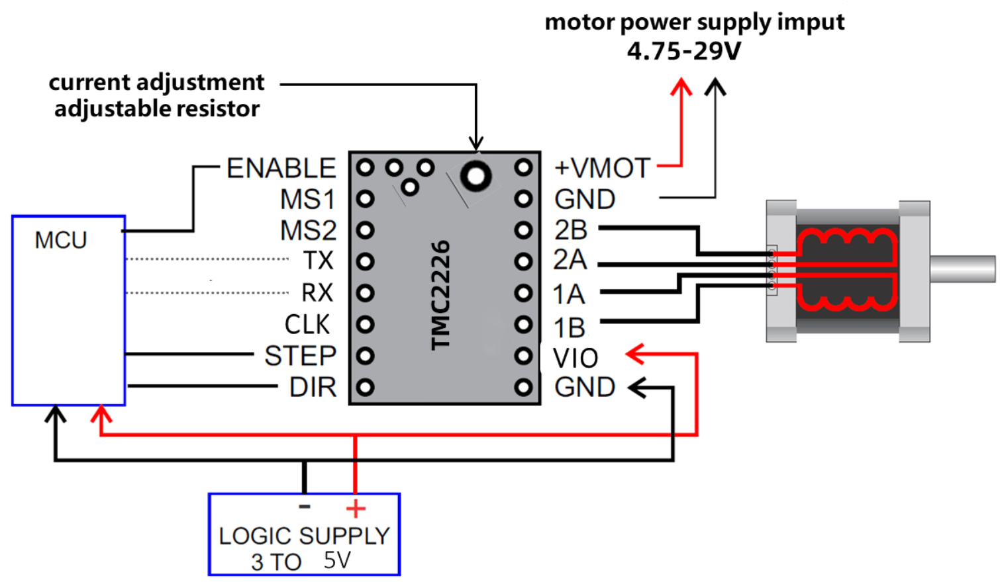

# Stepper Motor Coil Identification Methods

Most NEMA 17 bipolar stepper motors have four wires corresponding to two independent electromagnetic coils.

The objective is to identify: **Coil A** (A+ and A-) and **Coil B** (B+ and B-)

>i If you have access to the motor's datasheet, you can find the coil specifications there.

In our case, we use NEMA 17 motors (model: 17HS4401) from two different brands and the datasheet from these manufacturers are not available.

To identify the coil connections, the following three methods shown in the video can help us:

---

## Method 1: Multimeter Resistance Test (Recommended)

### Required equipment
- Digital multimeter.

### Procedure

1. Set the multimeter to resistance (Ω) or continuity mode.
2. Select any two motor wires.
3. Measure the resistance between them.
4. Repeat the measurement with different wire combinations.
5. Identify the two pairs that show a measurable resistance.

### Results

| Brand | Wire combination | Measurement | Result |
|---|---|---|---|
| Usongshine | Black – Green | 3.3 Ω | Coil A (to confirm) |
| Usongshine | Red – Blue      | 3.3 Ω | Coil B (to confirm) |
| Usongshine | Red – Green   | 0 Ω    | Different coils |
| Usongshine | Red – Black    | 0 Ω    | Different coils |
|---|---|---|
| R3M1717    | Black – Blue   | 2.5 Ω | Coil A (to confirm) |
| R3M1717    | Red – Green  | 2.5 Ω | Coil B (to confirm) |
| R3M1717    | Red – Blue     | 0 Ω    | Different coils |
| R3M1717    | Red – Black   | 0 Ω    | Different coils |

### Interpretation

- Two wires with measurable resistance belong to the same coil.
- Two wires from different coils should show an open circuit (0 Ω).
- Typical winding resistance depends on the motor model or brand.

>i **Note:** The wire color coding may vary depending on the manufacturer and the supplied cable. Always verify the wiring before connecting to the driver.

---

## Method 2: LED Generation Test

### Required equipment
- One LED.
- Connecting wires or alligator clips.

### Procedure

1. Connect the LED directly across two motor wires.
2. Rotate the motor shaft manually.
3. Observe whether the LED flashes.
4. Repeat with different wire combinations.

### Results

When the selected wires belong to the same coil, manually rotating the shaft generates a voltage in the winding.

This voltage can illuminate or flash the LED.

In our case, the LED flashes for the wire combinations that have measurable resistance (see previous table), confirming that they belong to the same coil in each brand.

**Advantages:**

- Does not require a multimeter.
- Demonstrates electromagnetic induction.
- Useful for identifying winding pairs.

**Limitations:**

- LED illumination depends on rotation speed and generated voltage.
- Some LEDs may not light up due to polarity or low voltage.

---

## Method 3: Shaft Resistance (Electromagnetic Braking) Test

### Required equipment
- No special equipment required.

### Procedure

1. Hold the motor shaft and rotate it gently.
2. Observe the force required to rotate the shaft.
3. Short-circuit two motor wires together.
4. Rotate the shaft again.
5. Compare the resistance to rotation.
6. Repeat with other wire combinations.

### Results

When two wires belonging to the same coil are shorted together, the motor generates current as the shaft rotates.

This produces electromagnetic braking, making the shaft noticeably harder to turn.

When wires from different coils are shorted together, this effect should not occur in the same way.

For our case, we notice a significant difference in rotational resistance between the wire combinations with measurable resistance, also confirming that they belong to the same coil in each brand.

**Advantages:**

- No additional equipment required.
- Quick and easy to perform.
- Useful as an additional confirmation.

**Limitations:**

- The difference in rotational resistance can be subtle.
- Results depend on motor construction and rotational speed, as well as user perception.

---

## Coil Polarity Identification and Driver Connection

Once both coil pairs have been identified, they can be connected to a stepper motor driver.

>! **Safety Precautions**
>!
>! - Never connect or disconnect motor wires while the stepper driver is powered.
>! - Never measure winding resistance while the motor is connected to an energized driver.
>! - Avoid shorting motor wires while the driver is powered.
>! - Disconnect the motor from the driver before performing identification tests.
>! - Do not exceed the motor or driver current ratings.

### Example: TMC2226

| Driver terminal | Motor connection |
|---|---|
| 1A | Coil A+ wire 1 |
| 1B | Coil A- wire 2 |
| 2A | Coil B+ wire 1 |
| 2B | Coil B- wire 2 |

### Determining polarity

The two wires belonging to each coil can initially be connected in either order.

**For example:**

Brand 1:

- Coil A: Black → 1A, Green → 1B
- Coil B: Red → 2A, Blue → 2B

Brand 2:

- Coil A: Black → 1A, Blue → 1B
- Coil B: Red → 2A, Green → 2B

>i **Important:** The relative polarity of the windings determines the motor's rotation direction.

By using a control circuit or the pump controller, we can verify the rotation direction. If the motor rotates in the opposite direction than expected, reverse the order of one coil or invert the direction signal in software.

In our case, we used the pump controller to verify the rotation direction, having the final configuration as follows:

| Brand | Driver terminal | Motor connection |
|---|---|---|
|Usongshine | 1A | Red → Coil A+ |
|Usongshine | 1B | Blue → Coil A- |
|Usongshine | 2A | Black → Coil B+ |
|Usongshine | 2B | Green → Coil B- |
|---|---|---|
|R3M1717 | 1A | Red → Coil A+ |
|R3M1717 | 1B | Green → Coil A- |
|R3M1717 | 2A | Black → Coil B+ |
|R3M1717 | 2B | Blue → Coil B- |

## Final Recommendation

The **multimeter resistance test** (Method 1) is the recommended approach for identifying NEMA 17 motor coils.

The other two methods can be used as complementary tests when a multimeter is unavailable or when additional confirmation is desired.

